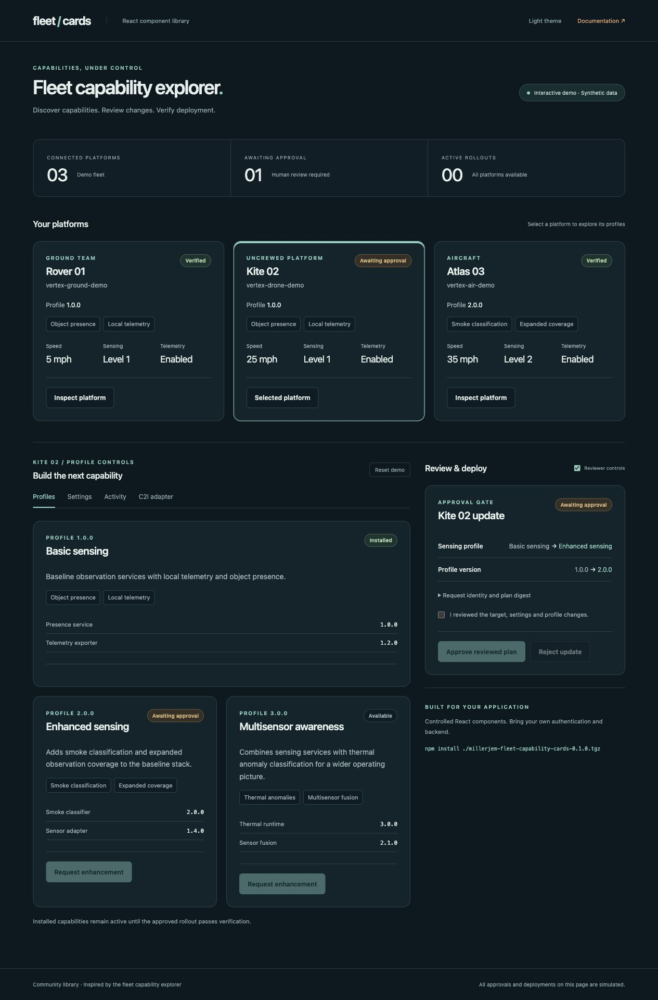

# Fleet capability cards

A JavaScript React library for capability explorer interfaces: platform cards, profile enhancements, deployment settings, reviewed approvals, rollout progress, and activity history. Includes an interactive demo and a Docker image recipe.

Inspired by the fleet capability explorer's dark ink canvas, teal controls, capability chips, and request → review → verify workflow. This is a community reference library, not an official Spectro Cloud product.



## Run the demo with Docker

```sh
git clone https://github.com/millerjem/fleet-capability-cards.git
cd fleet-capability-cards
docker compose up --build
```

Open [localhost:8080](http://localhost:8080). Stop with `docker compose down`.

A prebuilt Linux amd64 container is also available from [GitHub Releases](https://github.com/millerjem/fleet-capability-cards/releases/latest). Download `fleet-capability-cards-demo.tar.gz`, then run:

```sh
docker load -i fleet-capability-cards-demo.tar.gz
docker run --rm -p 127.0.0.1:8080:8080 fleet-capability-cards:demo
```

For Apple Silicon or other architectures, use the Compose source build above.

The multi-stage build compiles the React demo and serves it through unprivileged Nginx on port 8080. Compose binds to your computer's loopback interface. No API keys, login, cluster, external fonts, maps, telemetry feeds, or backend are needed.

1. Select Rover, Kite, or Atlas.
2. Request **Enhanced sensing** or **Multisensor awareness**, or edit the Settings tab.
3. Inspect the proposed changes and confirm the review checkbox.
4. Approve or reject. Installed capabilities change only after the simulated rollout reaches verification.
5. Explore activity history, the C2I adapter, and light/dark themes.

All data, approvals, and rollouts in this demo are synthetic and kept in memory. Refresh or **Reset demo** restores the starting state. The Reviewer controls switch demonstrates presentation only; it is not an authentication system.

## Use the library in your application

Requires React 18.2+ or React 19, with React DOM. Build tooling requires Node 22.12+; Docker uses Node 24.

The source is public on GitHub. **It has not been published to the npm registry.** Download the installable `.tgz` from [GitHub Releases](https://github.com/millerjem/fleet-capability-cards/releases/latest), or build it from the checkout:

```sh
npm ci
npm test
npm run build
npm pack
# In your React application:
npm install /path/to/fleet-capability-cards/millerjem-fleet-capability-cards-0.1.0.tgz
```

Import the components and their scoped stylesheet:

```jsx
import { CapabilityCard, ProfileCard } from "@millerjem/fleet-capability-cards";
import "@millerjem/fleet-capability-cards/styles.css";

export function Platform() {
  return (
    <div style={{ display: "grid", gap: 20 }}>
      <CapabilityCard
        name="Kite 02"
        platform="Uncrewed platform"
        cluster="your-cluster-name"
        profileVersion="1.0.0"
        status="Ready"
        capabilities={["Object presence", "Local telemetry"]}
        metrics={[{ label: "Sensing", value: "Level 1" }]}
      />
      <ProfileCard
        name="Enhanced sensing"
        version="2.0.0"
        description="Adds smoke classification and expanded observation coverage."
        capabilities={["Smoke classification", "Expanded coverage"]}
        status="Available"
        onRequest={async () => {
          const response = await fetch("/api/profile-requests", {
            method: "POST",
            headers: { "Content-Type": "application/json" },
            body: JSON.stringify({ capability: "enhanced-sensing" }),
          });
          if (!response.ok) throw new Error("Request failed");
        }}
      />
    </div>
  );
}
```

`/api/profile-requests` is an example route in **your application**. Components do not provide or call management APIs themselves. They receive data through props and call your callbacks. Use your existing application backend to authenticate users, authorize targets, create requests, and return current state.

## Components

| Export           | Purpose                                                        | Main props                                                                                         |
| ---------------- | -------------------------------------------------------------- | -------------------------------------------------------------------------------------------------- |
| `CapabilityCard` | A platform's installed capabilities and metrics                | `name`, `platform`, `cluster`, `profileVersion`, `capabilities`, `metrics`, `selected`, `onSelect` |
| `ProfileCard`    | Available or installed profile with component versions         | `name`, `version`, `description`, `status`, `capabilities`, `components`, `onRequest`              |
| `SettingsCard`   | String-valued variable form with local draft and validation    | `fields`, `revision`, `onSubmit`, `disabled`, `onDirtyChange`                                      |
| `ApprovalCard`   | Proposed before/after changes and explicit review              | `requestUID`, `planDigest`, `changes`, `onApprove`, `onReject`                                     |
| `RolloutCard`    | Progress and stages, with completion reserved for verification | `status`, `progress`, `steps`, `activeStep`, `message`                                             |
| `ActivityCard`   | Change history supplied by your backend                        | `events`                                                                                           |
| `C2IProfileCard` | Composite card for C2I schema v1 JSON                          | `card`, `canApprove`, `onRequest`, `onApprove`, `onReject`                                         |
| `StatusBadge`    | Consistent phase display                                       | `status`                                                                                           |

TypeScript declarations ship with the package. Import prop types such as `SettingsCardProps`, `ApprovalIdentity`, `C2ICard`, and `SettingField` from the same entry point. JavaScript consumers need no TypeScript setup. Both ESM and CommonJS builds are included; React is a peer dependency and is not bundled into the library.

### Settings and revisions

```jsx
<SettingsCard
  revision={serverRevision}
  fields={[
    {
      name: "replicas",
      label: "Replicas",
      value: "2",
      format: "number",
      min: 1,
      max: 10,
      required: true,
    },
    {
      name: "mode",
      label: "Mode",
      value: "standard",
      options: [
        { value: "standard", label: "Standard" },
        { value: "expanded", label: "Expanded" },
      ],
    },
    { name: "reporting", label: "Reporting", value: "true", format: "boolean" },
  ]}
  onSubmit={async (settings) => createRequest(settings)}
/>
```

Values and callback payloads are strings, matching profile variable APIs. Settings validation covers required values, finite numbers, minimum/maximum limits, and option membership. Your backend must validate the complete schema and authorization. Changing `revision` or server-provided field values discards stale local drafts. Async callbacks disable their controls while pending and display a generic error if they reject. A successful callback means the request was submitted, not that a deployment completed.

### Reviewed approvals

```jsx
<ApprovalCard
  requestUID={request.uid}
  planDigest={request.planDigest}
  changes={[{ label: "Replicas", before: "2", after: "3" }]}
  onApprove={async ({ requestUID, planDigest }) =>
    approveRequest({ requestUID, planDigest })
  }
  onReject={async ({ requestUID, planDigest }) =>
    rejectRequest({ requestUID, planDigest })
  }
/>
```

Approvals require the review checkbox. Changing the UID, digest, or status clears confirmation. The component sends the exact reviewed identity and blocks duplicate decisions while pending. The backend must independently check reviewer authority, the current request digest, target access, CSRF protection, and concurrency. Hide action props from users who cannot perform the action; hiding a control does not grant or enforce permissions.

Only set `RolloutCard status="Ready"` after backend verification. While another status is present, progress is capped at 99% even if an upstream source reports 100. The library does not infer readiness from elapsed time.

## Integrate with the C2I operator

This library can consume `card.json` generated by [millerjem/c2i-operator](https://github.com/millerjem/c2i-operator):

```jsx
import { C2IProfileCard } from "@millerjem/fleet-capability-cards";

<C2IProfileCard
  card={cardFromYourBackend}
  canApprove={currentUser.canReview}
  onRequest={async ({ name, requestUID, settings }) => {
    // Backend maps the existing request to an authorized target and
    // creates a NEW immutable ProfileRequest with the proposed settings.
    await createProfileRequest({ name, requestUID, settings });
  }}
  onApprove={async ({ requestUID, planDigest }) => {
    // Reviewer-only backend route creates a matching ProfileApproval.
    await approveProfileRequest({ requestUID, planDigest });
  }}
  onReject={async ({ requestUID, planDigest }) => {
    await rejectProfileRequest({ requestUID, planDigest });
  }}
/>;
```

Fetch the card through your authenticated application backend; never give a browser Kubernetes or VerteX credentials. Refresh the card after a callback and while deployment is pending. The adapter filters sensitive, hidden, immutable, and credential-named fields. It disables approval of the original plan while its settings form has staged edits. Raw pack values and sensitive settings must remain server-side.

The C2I adapter demo uses a fixture and logs callback payloads. It does not contact the operator or a cluster.

## Styling and embedding

All library CSS uses the `fc-` prefix and applies to component elements. It does not reset your application's body, headings, or buttons. Layout is supplied by your application; cards fill their containing grid cell. No router, icon library, CSS framework, map engine, or font download is required.

Dark is the default. Wrap cards in `<div data-fc-theme="light">` for a light palette. Override scoped custom properties from a stylesheet loaded **after** the library styles:

```css
.my-app .fc-card {
  --fc-bg: #10232c;
  --fc-panel: #0c1c25;
  --fc-border: #2a414b;
  --fc-text: #e4efeb;
  --fc-muted: #a0b7ba;
  --fc-accent: #8acfc0;
  --fc-font: Inter, system-ui, sans-serif;
}
```

Forms have associated labels and validation messages; progress has an accessible name; buttons support keyboard use and visible focus. Motion respects `prefers-reduced-motion`. Text is rendered by React and review links accept only HTTPS URLs without embedded credentials.

## Development

```sh
npm ci
npm run dev              # localhost:4180
npm test                 # Interaction and simulation tests
npm run build:demo       # Library in dist/, demo in demo-dist/
npx tsc                  # Consumer type checks
npm pack --dry-run       # Inspect the installable package
npx prettier --check src demo tests '*.js' '*.mjs' '*.json'
```

CI runs interaction tests, builds the library/demo, checks consumer types and package contents, then builds and starts the Docker demo and checks its health endpoint. Tagged releases repeat validation and publish the installable React package and a prebuilt Linux amd64 Docker image archive to public GitHub Releases. Images are distributed as release downloads rather than through a container registry.

## License

MIT. Spectro Cloud, VerteX, React, and other marks belong to their respective owners. No official logos, fleet imagery, private endpoints, or operational data are included.
